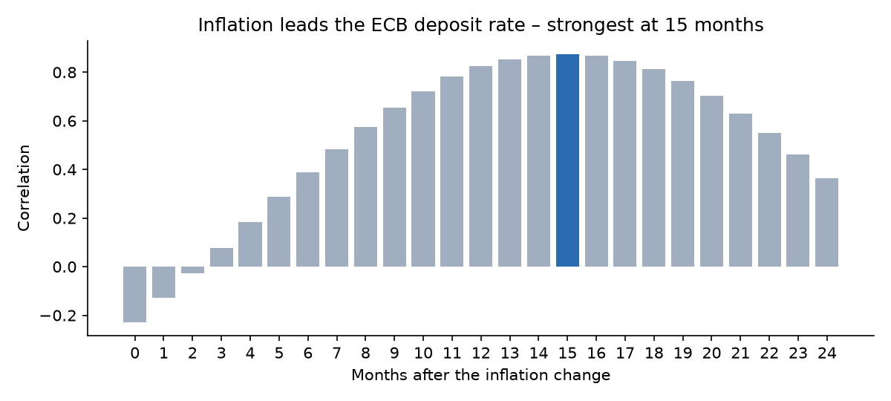
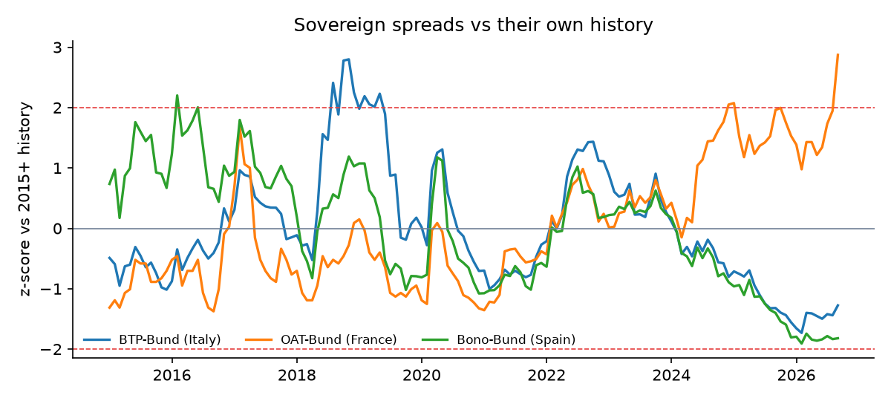

# Statistical analysis – data to Oct 2026

## 1. Does inflation lead ECB policy?
Correlation of 12-month changes in HICP inflation vs the deposit rate, shifted forward 0–24 months. The link is strongest when the rate is taken **15 months later** (r = 0.88, vs r = -0.23 with no lag): the ECB reacts to inflation with a delay.

## 2. What drives the Bund 10Y yield?
OLS on 141 monthly observations: `Bund 10Y = 0.29 + 0.65 × DFR + 0.08 × HICP`, **R² = 0.82**. Each 1 pp on the deposit rate goes with about 65 bps on the 10Y Bund; policy rate and inflation together explain 82% of the variation in the yield.

## 3. How stretched are sovereign spreads?
| Spread | Latest | Value (bps) | z-score | Percentile since 2015 |
|---|---|---|---|---|
| BTP-Bund (Italy) | Sep 2026 | 89 | -1.28 | 10% |
| OAT-Bund (France) | Sep 2026 | 97 | +2.87 ⚠️ | 100% |
| Bono-Bund (Spain) | Sep 2026 | 45 | -1.82 | 4% |

_Method notes: monthly data from the ECB Data Portal; correlations use 12-month changes to remove level trends; z-scores use the full 2015+ history. Correlation is not causation._
